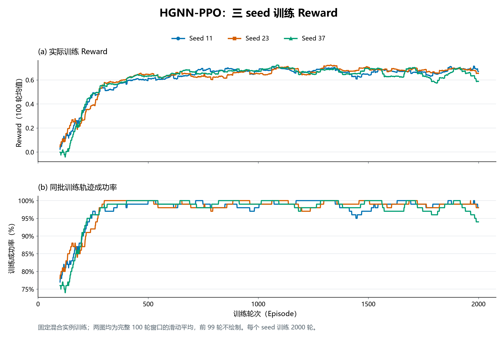
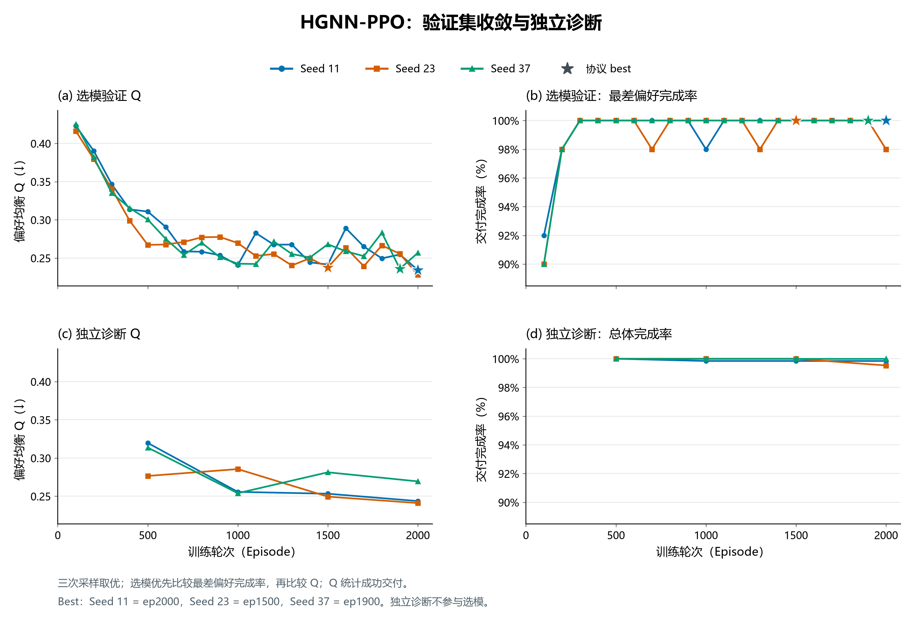
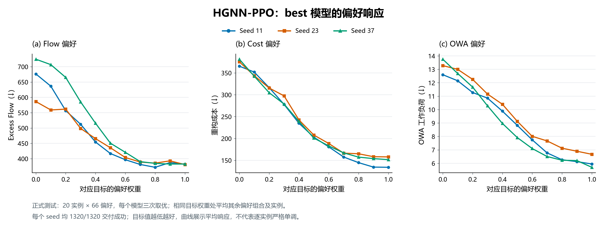
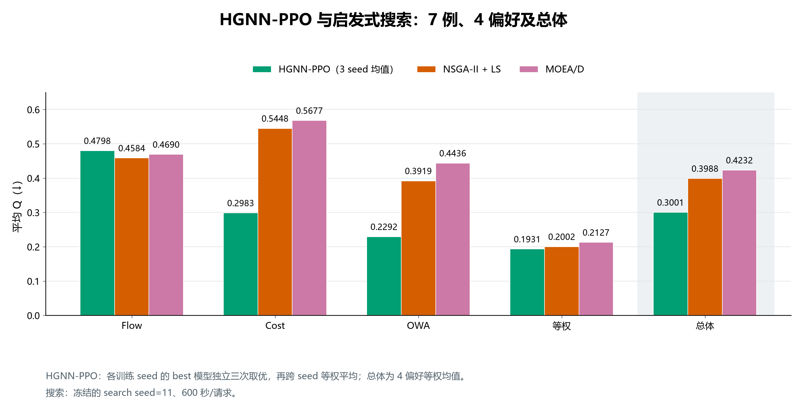

# HGNN-PPO 三 seed 结果图

数据沿用已核验的固定混合实例训练三 seed 汇总。

## 01_mix_reward

固定混合实例训练；两图均为完整 100 轮窗口的滑动平均，前 99 轮不绘制。每个 seed 训练 2000 轮。

[PNG](01_mix_reward.png) · [PDF](01_mix_reward.pdf) · [SVG](01_mix_reward.svg)

## 02_mix_convergence

三次采样取优；选模优先比较最差偏好完成率，再比较 Q；Q 统计成功交付。 
Best：Seed 11 = ep2000，Seed 23 = ep1500，Seed 37 = ep1900。独立诊断不参与选模。

[PNG](02_mix_convergence.png) · [PDF](02_mix_convergence.pdf) · [SVG](02_mix_convergence.svg)

## 03_mix_preference_response

正式测试：20 实例 × 66 偏好，每个模型三次取优；相同目标权重处平均其余偏好组合及实例。 
每个 seed 均 1320/1320 交付成功；目标值越低越好，曲线展示平均响应，不代表逐实例严格单调。

[PNG](03_mix_preference_response.png) · [PDF](03_mix_preference_response.pdf) · [SVG](03_mix_preference_response.svg)

## 04_hgnnppo_heuristic_comparison

HGNN-PPO：各训练 seed 的 best 模型独立三次取优，再跨 seed 等权平均；总体为 4 偏好等权均值。 
搜索：冻结的 search seed=11、600 秒/请求。

[PNG](04_hgnnppo_heuristic_comparison.png) · [PDF](04_hgnnppo_heuristic_comparison.pdf) · [SVG](04_hgnnppo_heuristic_comparison.svg)

复现：在项目根目录执行 `.\.venv\Scripts\python.exe -B result/analysis/mixed_instances_three_seed_20261022/mix_figures/plot_mix.py`。

输入文件哈希与导出清单见 [plot_manifest.json](plot_manifest.json)。
