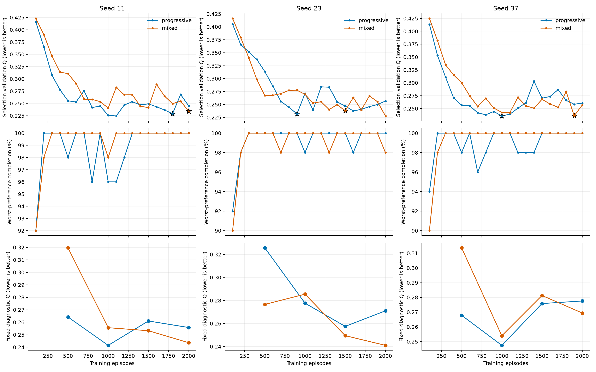
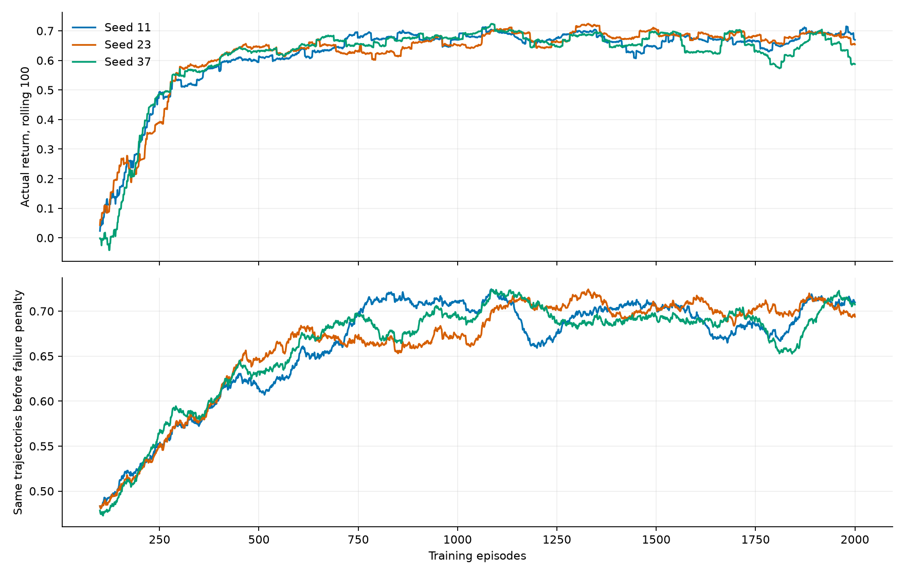
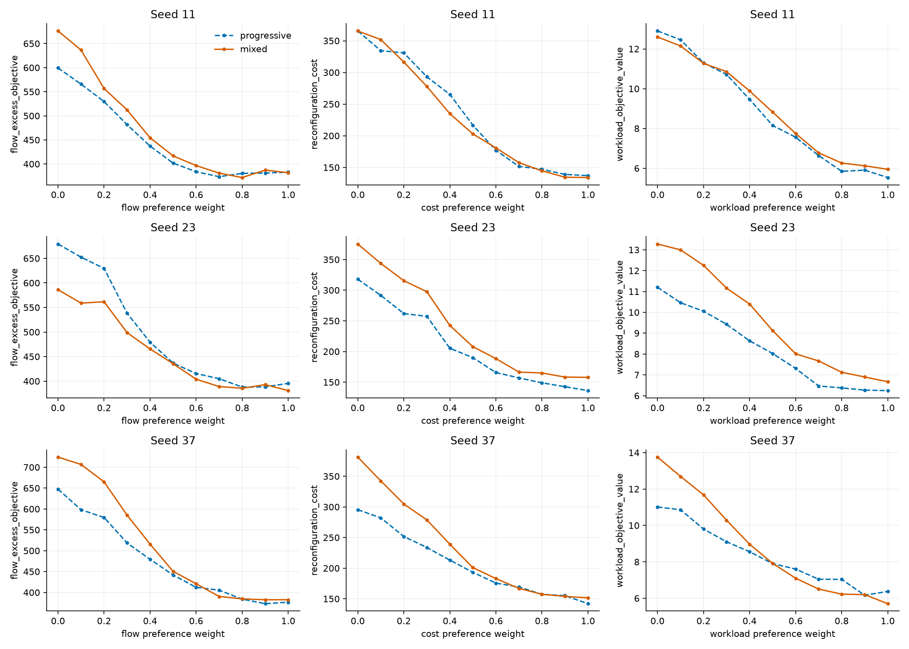
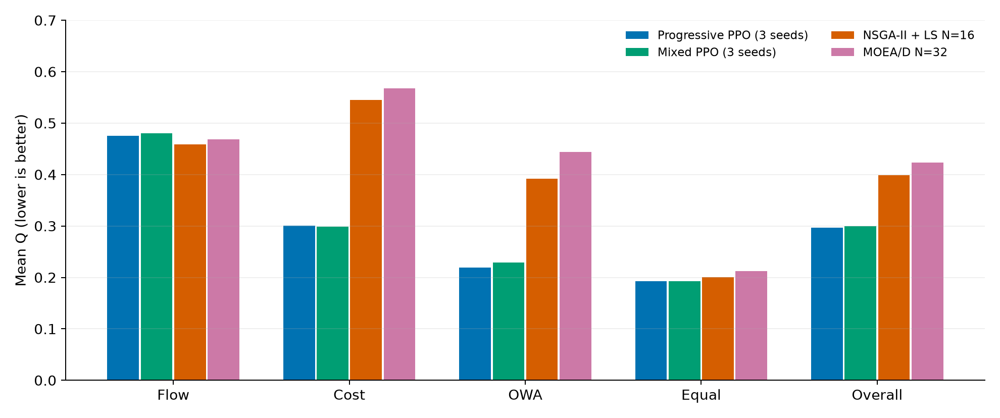

# 固定混合与渐进课程：三 seed 统一检查与比较

更新：2026-10-22，UTC+8。该报告替代截至2026-10-21的两seed阶段性汇总。两种课程均对齐seed11、23、37，各模型先在同一实例/偏好内三次取优，再跨训练seed等权汇总；不在seed之间取最优。

结论：mix三seed的原测试交付均全部完成，平均Q接近但略高于渐进课程；原始单次可靠性和后期波动的改善并不覆盖所有seed。偏好可控性均值略强，但存在方向与seed取舍。7例启发式补评已补齐，PPO成本/负载优势保持，Flow仍是搜索更强。没有新训练或根据测试重选checkpoint。

## 1. 完整性与身份

三组mix均完成2000episodes、100次PPO外层更新、20次选模验证、4次独立诊断和最终测试。正式原始日志重算通过1235项检查，包括完整采样三元组、原生质量公式、取优标记、选模事件、配置与checkpoint身份、物理约束和工程截断。原始验证/诊断/测试合计151812条，训练合计6000回合。

| mix seed | worker事件起止 UTC+8 | 耗时 | best ep |
| --- | --- | --- | --- |
| 11 | 2026-10-19 20:00:11 → 2026-10-20 17:19:54 | 21.34h | 2000 |
| 23 | 2026-10-20 17:20:39 → 2026-10-21 14:17:25 | 20.96h | 1500 |
| 37 | 2026-10-21 14:18:10 → 2026-10-22 11:14:34 | 20.95h | 1900 |

三个mix归档源码指纹一致，训练基点为58d5845且dirty。三个渐进归档源码指纹一致，基点8e1dfd7且dirty；新旧训练源码指纹不同。保存的实际配置除experiment_name、类别课程和severity课程锚点外一致，固定验证/诊断子集也一致。协议匹配不等于完全相同源码的严格因果实验。

当前工作区已另行整合默认训练与搜索优化（bc48ad2）。本报告按归档配置和产物核验；读取历史课程配置不调用当前训练入口。旧训练序列检查已改为核对实际日志中每100轮5/35/15/15/10/10/10配额和全程severity=1。

## 2. 原测试集：20例×66偏好

每seed原始3960条轨迹，形成1320个交付组合。正式Q按每偏好的成功交付均值再等权平均；Q越低越好，失败覆盖另列。Q不是最优性gap。

| seed | 课程 | best ep | 测试Q ↓ | 交付完成率 | 最差偏好完成率 | 原始完成率 |
| --- | --- | --- | --- | --- | --- | --- |
| 11 | progressive | 1800 | 0.226768 | 100.000% | 100.0% | 98.914% |
| 11 | mixed | 2000 | 0.228057 | 100.000% | 100.0% | 99.369% |
| 23 | progressive | 900 | 0.231404 | 99.697% | 95.0% | 96.768% |
| 23 | mixed | 1500 | 0.236580 | 100.000% | 100.0% | 98.636% |
| 37 | progressive | 1000 | 0.234070 | 100.000% | 100.0% | 98.005% |
| 37 | mixed | 1900 | 0.233998 | 100.000% | 100.0% | 97.045% |

| 课程 | Q均值±seed样本标准差 | 交付成功 | 原始完成率均值 |
| --- | --- | --- | --- |
| mixed | 0.232879 ± 0.004370 | 3960/3960 | 98.350% |
| progressive | 0.230747 ± 0.003695 | 3956/3960 | 97.896% |

mix正式平均Q高0.92%，交付完成率100%对99.899%。将失败交付辅助记为Q=1后，全覆盖均值为渐进0.231582、mix0.232879。官方成功样本Q与该辅助损失不可混用。

补入seed37后，不能再概括为“mix各seed单次可靠性都更好”：seed11/23原始成功率改善，但seed37从98.005%降至97.045%；三次取优弥补了这一差异。

同seed共同成功配对结果见test_paired.csv。seed37整体Q仅降低0.03%，但跨所有偏好的物理目标均值分别为：Flow 521.771→575.503、Cost 232.392→272.511、OWA 9.152→10.214。物理目标总体均值不携带各偏好权重，不能用它们反推非线性、偏好条件的Q；需结合端点与逐偏好结果评价。

## 3. 收敛与reward

| mix seed | best验证Q | ep2000验证Q | ep2000最差偏好完成率 | 判断 |
| --- | --- | --- | --- | --- |
| 11 | 0.234270 | 0.234270 | 100.0% | 最后一轮才获best，尚有学习与波动 |
| 23 | 0.237659 | 0.227855 | 98.0% | last Q更低但2格失败，保留1500轮best |
| 37 | 0.235912 | 0.256804 | 100.0% | last较1900轮best的Q差8.86%，尚未稳定 |

| seed | 后期验证Q标准差：渐进→mix | 后800轮reward标准差：渐进→mix | 后800轮训练失败：渐进→mix |
| --- | --- | --- | --- |
| 11 | 0.01161 → 0.01759 | 0.2620 → 0.2754 | 10 → 11 |
| 23 | 0.01425 → 0.01356 | 0.2913 → 0.2397 | 13 → 8 |
| 37 | 0.01535 → 0.01367 | 0.2768 → 0.3198 | 11 → 15 |

验证后期口径为ep1300–2000的8个检查点；reward后期口径为ep1201–2000的800条单次训练轨迹。两种标准差不是同一统计量。mix对验证Q波动的改善出现在seed23/37，对训练reward波动的改善仅出现在seed23；不能混称“mix整体更平稳”。

上图为100回合滚动reward，下图为同批轨迹账面扣除失败惩罚影响的回报，不是新奖励实验。mix消除了渐进课程severity=1处集中释放整数上界的共同台阶，但任务/偏好差异、少量失败和策略更新仍导致平台波动。所有学习率仍为1e-4，未触发衰减，不能视为已经完成小学习率精调。

独立诊断末轮mix Q为seed11/23/37的0.243641/0.241014/0.269395，低于渐进0.255810/0.271000/0.277552；但mix前两seed分别有1/637与3/637交付失败，seed37全部完成，渐进末轮三seed均全完成。质量与覆盖需一起报告。

平均每seed环境步数：渐进352732、mix433554（mix多22.9%）；总耗时均值20.50h与21.08h。相同episodes与外层updates不意味着相同交互步数、minibatch梯度步数或计算预算。

## 4. Best偏好响应

正式结果使用20例×66偏好的三次取优交付。相关性为同实例内目标权重与该目标值的Spearman，再平均20实例；下表使用同seed两课程共同成功组合（seed23为1316格，其余1320格）。负值越大表示总体方向更符合增大权重、降低目标的预期，不能代表绝对目标值更优。

| seed | 课程 | Flow | Cost | OWA |
| --- | --- | --- | --- | --- |
| 11 | progressive | -0.819 | -0.422 | -0.431 |
| 11 | mixed | -0.829 | -0.496 | -0.400 |
| 23 | progressive | -0.763 | -0.452 | -0.354 |
| 23 | mixed | -0.750 | -0.465 | -0.380 |
| 37 | progressive | -0.811 | -0.419 | -0.386 |
| 37 | mixed | -0.836 | -0.375 | -0.487 |

三seed相关系数均值：Flow渐进-0.798→mix-0.805，Cost -0.431→-0.445，OWA -0.391→-0.422。均值略强不等于各seed/方向均改善：seed37 OWA明显增强而Cost变弱，seed11 OWA略弱，seed23 Flow略弱。

| seed | 课程 | 局部Flow不变差 | 局部Cost不变差 | 局部OWA不变差 |
| --- | --- | --- | --- | --- |
| 11 | progressive | 72.0% | 69.0% | 72.0% |
| 11 | mixed | 76.0% | 70.0% | 67.0% |
| 23 | progressive | 66.7% | 63.0% | 54.1% |
| 23 | mixed | 74.7% | 70.0% | 63.3% |
| 37 | progressive | 70.0% | 65.0% | 61.0% |
| 37 | mixed | 69.0% | 69.0% | 74.0% |

局部检查固定其余两权重相等，自身权重按0,.2,.4,.6,.8,1递增，配对同实例相邻、两种模型均成功的结果。seed23 Flow/OWA分母99/98，其余100。有限采样下仍有反向变化，不能声称严格单调。

| seed | 课程 | 纯Cost负载 | 纯OWA负载 | 切换后负载降低 | 切换后成本变化 |
| --- | --- | --- | --- | --- | --- |
| 11 | progressive | 6.294 | 5.534 | +12.08% | -6.74% |
| 11 | mixed | 6.343 | 5.947 | +6.24% | +9.56% |
| 23 | progressive | 5.965 | 6.244 | -4.68% | +10.98% |
| 23 | mixed | 7.076 | 6.669 | +5.75% | +6.32% |
| 37 | progressive | 6.088 | 6.376 | -4.73% | +13.14% |
| 37 | mixed | 6.522 | 5.700 | +12.59% | -14.13% |

mix三个seed纯OWA端点的负载都低于各自纯Cost端点，修正了渐进seed23/37的平均反转。但seed37 mix纯OWA成本也比纯Cost低14.13%，提示成本端点仍有未充分优化之处；这种端点结果不能证明纯偏好已接近对应单目标最优。所有纯端点均20/20完成。

曲线按自身权重分组平均，单纯形上其他权重也随之变化；seed23成功集合有小差异。匹配相关性与局部配对另有严格共同样本表。

## 5. 对齐后的7例×4偏好启发式比较

沿用既有7例：balanced_2000223、easy_2000056、fatigue_2000124、arrival_2000222、machine_2000182、reconfiguration_2000066、worker_2000018；4偏好为三个端点及等权。PPO每模型各自三次取优，再平均三个训练seed。NSGA-II+LS N=16、MOEA/D N=32，均为此前冻结的搜索seed11、每请求600秒结果。

| 偏好 | 渐进PPO 3seed | mix PPO 3seed | NSGA-II+LS | MOEA/D |
| --- | --- | --- | --- | --- |
| Flow | 0.475059 | 0.479841 | 0.458413 | 0.468982 |
| Cost | 0.300358 | 0.298329 | 0.544813 | 0.567689 |
| OWA | 0.219301 | 0.229230 | 0.391858 | 0.443629 |
| Equal | 0.193045 | 0.193082 | 0.200164 | 0.212662 |
| Overall | 0.296941 | 0.300121 | 0.398812 | 0.423240 |

| seed | 渐进Q | mix Q | mix相对变化 | mix胜NSGA/28 | mix胜MOEA/D/28 |
| --- | --- | --- | --- | --- | --- |
| 11 | 0.296760 | 0.295565 | -0.40% | 16 | 20 |
| 23 | 0.294825 | 0.308791 | +4.74% | 17 | 19 |
| 37 | 0.299238 | 0.296006 | -1.08% | 16 | 21 |

mix总体Q较渐进高1.07%；较NSGA-II+LS低24.75%，较MOEA/D低29.09%。这些是归一化偏好代价差，不是物理目标同比降幅。优势仍主要在Cost/OWA，Flow平均Q仍由搜索占优。

本次新增seed37共84条PPO采样轨迹，复用seed11/23此前168条；统一为252条→84份交付，原始成功249/252，交付84/84。逐请求保存动作、排程、指标与取优证据；6个新旧模型的配对数据均核验。

补评源码变更已显式处理：本地较上次新增在线生成器延迟创建和环境查询优化。seed37所有84条动作轨迹又在58d5845原环境源码中重放，全部动作合法，Flow/Cost/OWA/Q/疲劳指标最大误差0。三个mix模型与历史选模日志重叠的12格Q、取优repeat和动作哈希全部一致；前两seed已有请求原样保留。

该7例是搜索调参子集，每类压力仅1例，搜索只有1个seed，PPO选模集与之重叠1例。不能作为独立确认结果。600秒搜索预算充分性未被本次证明；不同机器与并发方式不用于正式加速比。实例bootstrap只衡量这7例中的实例不确定性，不能代替训练seed或搜索seed不确定性。

## 6. 对此前判断的统一修订

- “等待seed37再做三seed结论”已完成；新的权威表是本报告，不再混用渐进3seed与mix2seed。
- “mix单次完工率提升”收窄为跨seed均值提升、seed11/23改善，seed37下降。
- “mix更稳定”不成立为普遍结论：两seed验证Q波动略降，但reward波动仅seed23降低。
- “mix偏好更合理”限于总体趋势和部分端点；局部反转、成本端点不足与不同seed取舍仍在。
- 两套模型均保留原协议best，不根据新增补评重选。结果支持完工、质量与偏好可控性之间的权衡，尚不支持宣称固定混合全面优于渐进课程。

## 7. 复核与复用

`audit.json`为三seed正式日志核验；`unified_verification.json`为统一补评及输入保护核验。`comparison_summary.csv`、`comparison_validation.csv`、`reward_windows.csv`、`preference_correlations_matched.csv`、`preference_monotonicity_matched.csv`、`heuristic_preferences_overall.csv`为本文数值依据。

`unified_raw_samples.csv`含完整三seed252条补评，`unified_selected_samples.csv`含84份交付，`unified_paired_comparison.csv`含168行与两搜索的逐模型配对。当前目录原始`raw_samples.csv`/`selected_samples.csv`是新增seed37单模型的84/28条，不能误作三seed汇总；其余原始请求保留在20261021目录。

执行脚本：audit_mixed.py、compare_training.py、align_details.py、run_seed37_eval.py、replay_previous_environment.py、finalize.py、write_report.py。新增补评身份冻结，原有请求文件和checkpoint均保持原哈希。所有图另存PDF用于导出。
